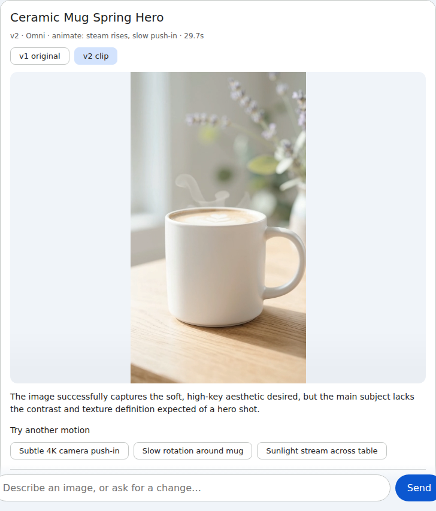

# Agent-I:X

A creative director agent for Gemini Enterprise. It generates an image, **looks at the
result**, and builds a control surface for that specific asset with
[A2UI](https://a2ui.org) v0.9: quick fixes, guiding questions, filter gauges, render
settings and version history. Every control feeds back into the agent, so refining an
image is clicking, not prompt engineering.

Built with [ADK](https://adk.dev), served over A2A from Agent Runtime, and rendered by
Gemini Enterprise's composite catalog. The same A2UI output also renders in a small
local `@a2ui/lit` client.

New to A2UI in Gemini Enterprise? Start with Yonit Gruber-Hazani's
[Your Enterprise Agent Talks Too Much. Give It a UI with A2UI on Cloud Run](https://medium.com/google-cloud/your-enterprise-agent-talks-too-much-give-it-a-ui-with-a2ui-on-cloud-run-4657e2b433a3)
([repo](https://github.com/yonitg/ge-agent-a2ui)), which covers the protocol and
registration. This project is a follow-up; the write-up is in [docs/ARTICLE.md](docs/ARTICLE.md).

<p>
  
  
  
</p>

## What it does

- **Two kinds of controls.** Tone gauges (warmth, exposure, contrast, grain…) run in
  Pillow with no model call. They preview live as you drag, in GE too, and only *Apply*
  renders (see Live filter preview). Meaning-level changes (quick fixes, answers, notes) are Nano Banana edits.
- **Controls chosen per asset.** After each render, a Gemini vision critique picks the
  quick fixes, two guiding questions, the gauges worth showing and motion ideas.
- **Guiding questions.** Pick answers to several questions, add a note, apply them as
  one edit. "Ask me more" (or "help me think about the lighting") brings new questions
  without rendering anything.
- **Intent routing.** Each message is either a render, a studio interaction that renders
  nothing, or plain conversation, which gets a text reply and no card.
- **Model tiers.** Nano Banana 2 Lite (default, fast drafts), Nano Banana 2 or Nano Banana
  Pro, picked in the studio or by name ("use Pro"). The choice sticks.
- **Reframe and new take.** Aspect ratio changes recompose the image with the model
  instead of cropping; "new take" re-renders from the prompt.
- **Versions.** Every version is kept (`chats/<chat>/v003-edit-image-….jpg`). "Go back to v2",
  "undo" or a version chip restores one without regenerating. Unapplied slider values
  travel with the next edit.
- **Upscale and animate.** 2K or 4K re-render with the selected model (Lite upscales with
  Nano Banana 2; Pro falls back to Nano Banana 2 on quota errors, with a badge) and a ~4
  second Omni clip.
- **Save to Drive.** Exports the current version (or all versions) to the user's own
  Drive, as the user, with the `drive.file` scope. On Agent Runtime this becomes a
  Download button (see Known limits).

Measured on local runs (global endpoint): Lite render 3.5–5 s, edit 3.5–10 s, 4K
upscale 26 s with Nano Banana 2 and 39 s with Pro, Omni clip 30 s. Filters make no model call.

## Layout

```
app/agent.py           # LlmAgent, instruction with intent routing and UI action mapping
app/tools.py           # Studio tools: create/refine/adjust/reframe/regenerate/upscale/
                       #   animate/revert/questions/export; asset lineage in session state
app/executor.py        # A2A executor: A2UI actions -> agent turns, user token, pending filters
app/card.py            # Agent card with the A2UI v0.9 extension and the GE catalog
app/studio/surface.py  # Builds and validates the A2UI surface against the GE catalog
app/studio/critique.py # Gemini vision critique and guiding questions (structured output)
app/studio/media.py    # Nano Banana generate/edit/reframe/upscale, Omni animate
app/studio/filters.py  # Pillow filters
app/studio/live_preview.py # formatString SVG that previews the gauges in the browser
app/studio/assets.py   # Local or GCS storage, signed URLs
app/studio/drive.py    # Drive export over REST with the user's token
app/dev_server.py      # Local A2A JSON-RPC server that also serves assets
client/                # Vite + @a2ui/lit client with a Material catalog
tests/unit, tests/integration, tests/eval
```

## Run it locally

Requires [uv](https://docs.astral.sh/uv/), Node 20+, `gcloud` with Application Default
Credentials, and a project with Vertex AI enabled.

```bash
cp .env.example .env          # set GOOGLE_CLOUD_PROJECT
make install
make dev                      # A2A on :8000/a2a, assets on :8000/assets
make client                   # in another terminal: http://localhost:5173
```

Local assets go to `./.assets`. To try Drive export locally, log in with the Drive
scope and set `DRIVE_USE_ADC=true`:

```bash
gcloud auth application-default login \
  --scopes=openid,https://www.googleapis.com/auth/cloud-platform,https://www.googleapis.com/auth/drive.file
```

## Test

Pull requests also get an automated security review from PR-noia
(`.github/workflows/pr-review.yml`); comment `/review` on a PR to re-run it.

```bash
make test    # unit + integration
make eval    # routing evals (LLM-as-judge rubrics in tests/eval/eval_config.json)
make lint    # ruff + client type check
```

## Deploy to Gemini Enterprise

1. Create a private bucket for assets and a service account for the agent. The service
   account needs `roles/aiplatform.user`, `roles/storage.objectAdmin` on the bucket, and
   `roles/iam.serviceAccountTokenCreator` on itself (for signBlob), because GE loads
   images through V4 signed URLs.
2. Deploy. The Makefile sets `ASSETS_BUCKET` and turns on A2A streaming, which GE needs:

   ```bash
   make deploy PROJECT=your-project ASSETS_BUCKET=your-assets-bucket \
     SERVICE_ACCOUNT=agent-ix-app@your-project.iam.gserviceaccount.com
   ```

3. Create a GE authorization. Agent Runtime's A2A endpoint is a Google Cloud API, so
   every call needs an OAuth token, and GE only sends one to an A2A agent when an
   authorization is attached (without it, every call fails with
   `401 CREDENTIALS_MISSING`). GE signs the user in and calls the agent with their
   token; only the `cloud-platform` scope is requested. Create a Web OAuth client with the redirect URI
   `https://vertexaisearch.cloud.google.com/static/oauth/oauth.html`, download its JSON,
   then:

   ```bash
   uv run python deployment/create_ge_authorization.py <project-number> client_secret.json
   ```

4. Register the agent in your GE app as an A2A agent (an ADK registration would bypass
   A2A, and with it the A2UI surface). Use the card URL printed by deploy:

   ```bash
   make publish \
     GE_APP=projects/<number>/locations/global/collections/default_collection/engines/<app-id> \
     AGENT_CARD_URL=https://us-central1-aiplatform.googleapis.com/v1beta1/projects/<project>/locations/us-central1/reasoningEngines/<id>/a2a/v1/card \
     AUTH_ID=projects/<project-number>/locations/global/authorizations/agent-ix-auth
   ```

The remote build installs with pip, which ignores uv overrides, so the eval-only
`google-cloud-aiplatform[evaluation]` extra (and its litellm `jsonschema` pin) lives in
the `dev` group.

Settings are listed in `.env.example`: models, `DEFAULT_IMAGE_TIER`, `STUDIO_LAYOUT`
(`inline` card or `canvas` side panel), signed URL lifetime and Drive options.

## Live filter preview

GE runs no custom client code and has no CSS `filter` style, but it does evaluate
`formatString` in an `Image` url whenever the data model changes. The studio image is
therefore an SVG data URL whose CSS reads the slider values (`${/filters/exposure}`), so
dragging a gauge redraws it in the browser with no round trip. It mirrors the Pillow
math (most gauges within ~1 grey level out of 255), and shows the real render whenever
the sliders sit at their applied values. The embedded preview lives in the data model
(`/live/base`) because the A2UI reference renderer caps `formatString` templates at
10,000 characters. Each studio card is about 80 KB; `LIVE_PREVIEW_SIDE` sets the size.

## Known limits

- Every GE control except the gauges' preview is a round trip. `IFrameSrcdoc` renders
  nothing in GE, so there is no way to host custom HTML in the card.
- In GE, a model tier can only be named in the first message's text; after that, use the
  studio toggle.
- No Drive export from Agent Runtime. GE does send the user's token, but Agent Runtime
  replaces the `Authorization` header with its own ID token (audience: the engine's
  internal run.app URL), and Drive rejects that. `make deploy` sets `DRIVE_EXPORT=false`,
  which shows a Download button (a signed link to the full file) instead. Drive export
  works locally.
- GE's `MaterialImage` only loads allowlisted hosts and blanks signed GCS URLs
  (`about:blank`), so the studio uses the basic `Image` component, which loads them.

## License

Apache 2.0. See [LICENSE](LICENSE).
