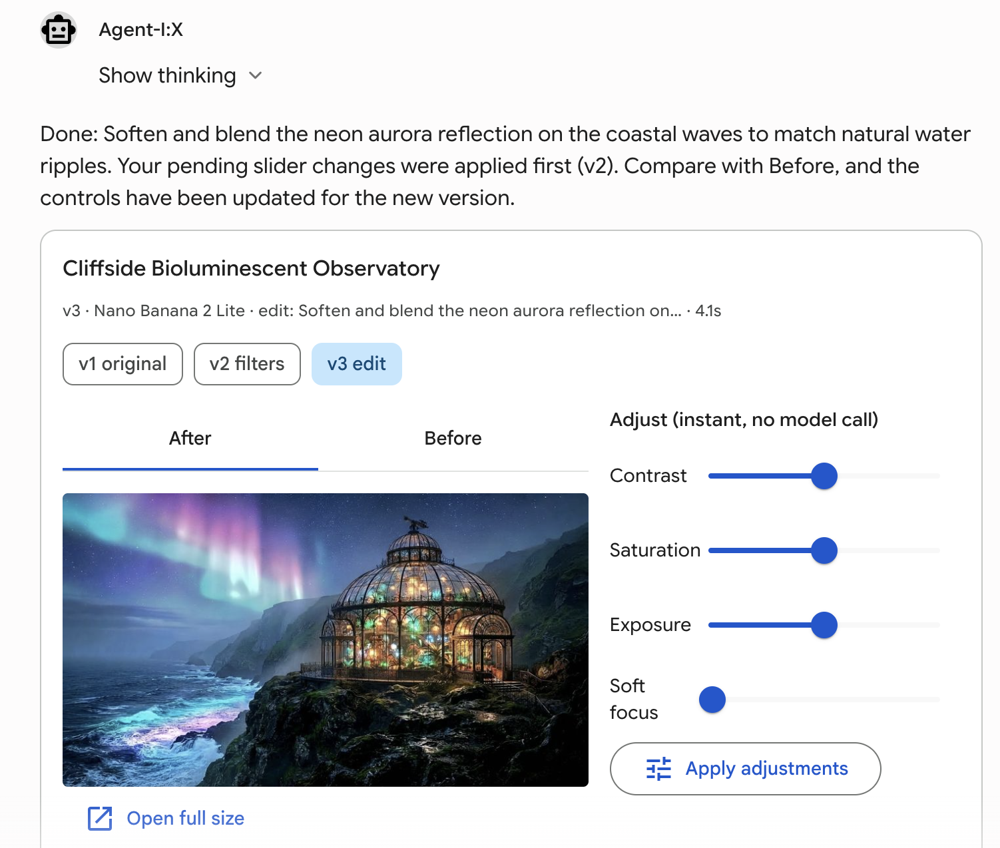
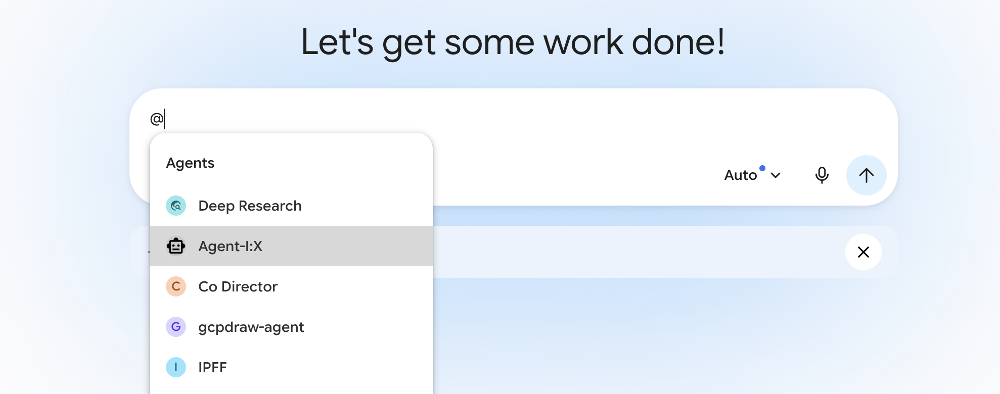
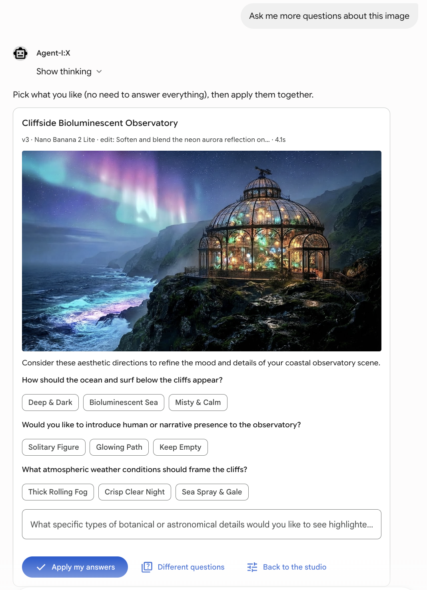
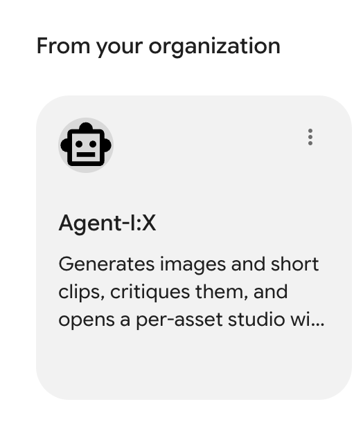
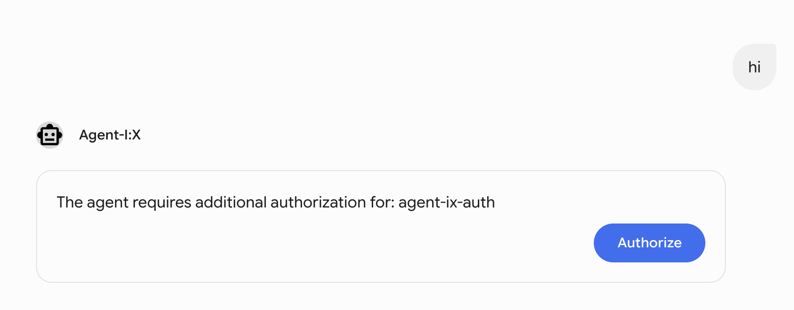
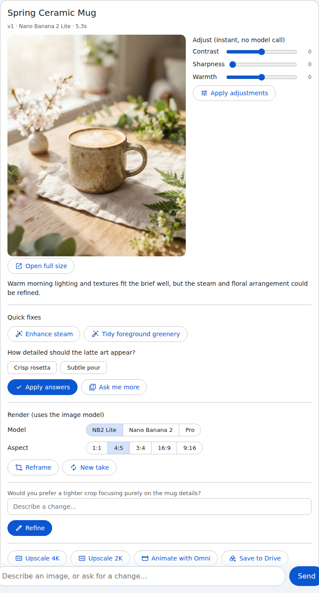

# Stop Prompting, Start Clicking: An Agent That Designs Its Own Studio with A2UI

### A follow-up on A2UI in Gemini Enterprise: the agent looks at each image it generates and builds the controls for that image. Running on Agent Runtime, with the gotchas I hit along the way.


*The studio in Gemini Enterprise after a quick-fix edit. The slider values the user hadn't applied went in first (v2), then the edit (v3).*

A few weeks ago my colleague Yonit Gruber-Hazani published
[Your Enterprise Agent Talks Too Much. Give It a UI with A2UI on Cloud Run](https://medium.com/google-cloud/your-enterprise-agent-talks-too-much-give-it-a-ui-with-a2ui-on-cloud-run-4657e2b433a3).
If you haven't read it, start there. It explains what A2UI is, walks through the
v0.9 messages (`createSurface`, `updateComponents`, `updateDataModel`), shows the
agent card extension, and registers a Cloud Run agent in Gemini Enterprise over A2A.
I won't repeat any of that here.

This post picks up where hers stops. Her operations dashboard shows the case for
A2UI over walls of text. I wanted to see what happens when the UI is the main way you
work, not a display: a creative studio where every control goes back to the agent,
and where the agent decides **which controls to show** by looking at what it just
made.

The code is at [github.com/omribt1/agent-ix](https://github.com/omribt1/agent-ix).

## The problem: prompt purgatory

Image models are good now. Iterating with them through a chat box is still painful. You get an image
that's 80% right and then you guess adjectives: "slightly warmer, softer
shadow, keep the mug where it is." Sometimes the model changes the whole scene.
Sometimes you just wanted a bit more exposure, which needs no model at all.

Creative people don't work that way. They grab a slider, compare before and after,
and answer questions like "studio background or outdoors?" So the goal for
Agent-I:X was simple: **refining an image should be done by clicking, not
prompt engineering**, and the clicking should happen where the user already is, in Gemini
Enterprise.

A2UI fits because, as Yonit explains, the agent sends declarative JSON and the host
renders its own vetted widgets. For a creative tool, that has two advantages beyond
safety. The controls look native in GE without any frontend work. And the same JSON
renders in any other A2UI host: the repo includes a small `@a2ui/lit` client that
renders the exact same surfaces locally.

## What the agent does

1. You @-mention Agent-I:X in Gemini Enterprise and ask for an image ("a hero shot of
   a ceramic coffee mug for our spring campaign"). The agent expands the prompt and renders it with Nano Banana 2 Lite by
   default (fast drafts). Nano Banana 2 and Nano Banana Pro are one toggle away.
2. A Gemini vision call **critiques the result**: what kind of subject it is, what
   works, what's off.
3. From that critique, the agent builds a studio card. It holds the image, quick-fix
   chips for flaws it can see, two guiding questions with options, the 3–5 tone gauges
   that matter for *this* image, render settings, a free-text box, and next steps
   (upscale, animate, download).
4. Every click is an A2A action back to the agent. The agent edits, re-critiques and
   sends a new card. Every version is kept, so "go back to v2" restores without
   regenerating.



## Controls chosen per asset

A portrait gets different questions and gauges than a product shot or a landscape.
That's the part I find most interesting about agent-generated UI: the surface isn't
a fixed template the agent fills in. It's chosen per asset.

The critique is a structured-output call. The model picks *what* to show; Python
decides *how* it renders:

```python
class Critique(BaseModel):
    subject_type: Literal["product", "portrait", "landscape", "food", "interior", "illustration", "other"]
    summary: str = Field(description="One sentence: what works and the main thing to improve.")
    quick_fixes: list[QuickFix] = Field(max_length=3, description="Specific flaws you can see.")
    questions: list[ClosedQuestion] = Field(min_length=1, max_length=2,
        description="Creative forks worth asking about for THIS image.")
    open_question: str = Field(description="One open question inviting a free-text refinement.")
    gauges: list[GaugeName] = Field(min_length=3, max_length=5,
        description="The pixel adjustments most useful for this image.")
    motion_ideas: list[str] = Field(min_length=2, max_length=3,
        description="2-5 word camera/subject motion ideas for a short clip.")
```

`GaugeName` is a `Literal` built from the filter registry, so the model can only
pick gauges that exist. They always appear in the registry's order, so a slider keeps
its place from card to card. If the pick doesn't suit you, ask: "show me grain",
"only exposure and contrast". A `change_gauges` tool swaps the sliders without
rendering anything, and the choice sticks for the rest of the chat. Each quick fix and each answer option carries the edit
instruction it will send to the image model, so a click maps directly to an edit.

I kept the A2UI JSON out of the LLM entirely. Deterministic Python builds the
surface; the critique only decides what goes into it.
Every surface is validated against the GE composite catalog before it's sent:

```python
if errors := catalog().validate_components(messages):
    raise InvalidSurface("; ".join(f"{e.path}: {e.message}" for e in errors))
```

That check caught more bugs than any other test in the repo.

## Two kinds of controls

Not every change needs a model. The studio splits controls by cost:

| Control | What runs | Measured |
|---|---|---|
| Tone gauges (warmth, exposure, contrast, grain…) | Live preview in the browser; *Apply* renders with Pillow, no model call | preview: no round trip; apply: one A2A round trip |
| Quick fixes, answers, free text | Nano Banana edit of the current image | 3.5–10 s |
| New image (Lite) | Nano Banana 2 Lite | 3.5–5 s |
| 4K upscale | Nano Banana 2 / Pro | 26 s / 39 s |
| Animate | Omni, ~4 s clip | ~30 s |

Gauges always apply to the last model-generated image, never on top of a previous
filter result, so any slider state can be reproduced. If you move sliders and then
click a quick fix without applying, the slider values travel with the edit instead
of being lost.


*"Ask me more" in Gemini Enterprise: new questions about the current image, with no new render. The chat bubble at the top is the button's `context.prompt`, which GE shows as what the user said.*

## The action loop on Agent Runtime

The agent runs on **Agent Runtime** (deployed with `agents-cli`), which serves A2A
for you. GE calls the engine's `/a2a/v1` endpoints directly. Once
`make publish` registers it as an A2A agent, it shows up in the app's agent gallery
next to the others.



When the user clicks a control, GE sends a `DataPart` containing the A2UI action. ADK's
stock `A2aAgentExecutor` didn't fit for two reasons. It returns only the last event's
parts, and my A2UI comes from a tool response mid-turn. It would also pass the action
to the model as raw JSON. So the repo has a small custom executor that turns actions
into a compact text line for the model:

```python
def action_to_text(action: dict[str, Any]) -> str:
    hidden = {"prompt", "model", *(PENDING_FILTER_KEYS if _carries_filters(action) else ())}
    context = {k: v for k, v in (action.get("context") or {}).items() if k not in hidden}
    return f"[ui-action] {action['name']} context={json.dumps(context, ensure_ascii=False)}"
```

Slider values that ride along with an edit go into session state, not the prompt.
The tool applies them exactly instead of trusting the model to copy eight numbers
into a second call. The instruction maps each `[ui-action]` name to a tool call with
no confirmation step.

Two details from the GE side:

- **`context.prompt` is what the user "said".** GE shows it as the chat message for the
  click, so every action carries a human sentence ("Apply my answers").
- **Use a fresh `surfaceId` per response.** Reusing one across turns confused the
  renderer.

## What I hit in Gemini Enterprise

None of these were in the docs I had, and each cost me an afternoon.

**Agent Runtime needs an OAuth authorization.** Agent Runtime's A2A endpoint is a
Google Cloud API (`aiplatform.googleapis.com`), so every call needs an OAuth token,
and GE only sends one to an A2A agent when an authorization resource is
attached to it. Without one, I got `401 CREDENTIALS_MISSING` on every call. The fix is
a Web OAuth client with GE's redirect URI, an authorization resource that uses it with
the `cloud-platform` scope, and `--authorization-id` at publish time. GE then signs the
user in once and calls the Agent Runtime endpoint with their token. The repo has a script that creates
the authorization (`deployment/create_ge_authorization.py`), and `make publish`
attaches it.

It's an extra setup step, but it's the more secure arrangement. Every request reaches
Agent Runtime authenticated as the signed-in user rather than as a shared service
account, so Google Cloud checks *that user's* permissions on the agent, and calls can
be audited per person (with Data Access audit logs turned on). Access is granted and
revoked per person in IAM. Nothing long-lived is shared: GE holds short-lived user
tokens. What your agent code receives is another matter, as the next point explains.


*The first time someone uses the agent, GE asks them to authorize it. After that, every call carries their own token.*

**The user's token doesn't reach your code on Agent Runtime.** Agent Runtime checks the
user's token, then replaces the `Authorization` header with its own Google-signed ID
token (audience: the engine's internal URL) before the request reaches the agent. So
the agent can't act as the user. I had a "Save to Drive" button that worked locally and
failed on Agent Runtime, so I dropped it for a Download button that opens a signed link
to the full file. If your agent needs to act in the user's Workspace, host it somewhere
that passes the user's token through.

**`MaterialImage` blanks signed GCS URLs.** Small thumbnails can be inlined as
base64, but a studio needs 1600 px previews, and 2K/4K files
behind "Open full size", so I store assets in a private bucket and send V4 signed URLs.
`MaterialImage` rendered them as `src="about:blank"`. A probe card showed it loads
`data:` and gstatic URLs but not signed GCS or Wikimedia URLs. The basic `Image`
component (and `Video`) loads them fine:

```python
def _image(b: _Builder, id_: str, url: str | dict, alt: str) -> str:
    # Basic Image, not MaterialImage: GE's MaterialImage only loads allowlisted hosts
    # and blanks signed GCS URLs (about:blank); Image and Video load them.
    return b.add(id_, "Image", url=url, description=alt, fit="contain", variant="largeFeature")
```

**No sticky or scrolling panels.** The catalog's `style` allowlist leaves out
`position` and `overflow` on purpose (the schema comment cites clickjacking,
CWE-1021). To keep the image in view while you adjust, the gauges sit beside the
image using `weight` and `minWidth`, and wrap under it on a narrow card.

**One build gotcha.** The Agent Runtime remote build installs with pip, which ignores
uv's `override-dependencies`. The evaluation extra of `google-cloud-aiplatform` pulls
litellm, whose `jsonschema` pin conflicts with the A2UI SDK, so it lives in the dev
dependency group only.

## Live filter preview, with no custom code in GE

Live preview was the hardest obstacle: it almost made me drop the gauges entirely. A
slider that does nothing until you click
*Apply* is a form, not a studio. GE gives you no way to run your own code: no CSS
`filter` style, no custom client functions, and a slider can't call the agent until a
button is clicked. I tried `IFrameSrcdoc` (an HTML page with a slider inside), and it
rendered nothing in our GE app.

What GE does have is data binding and `formatString`, and an `Image` url can be a
`formatString` call. GE evaluates it again whenever the data model changes, and the
sliders write to the data model. So the card's image is an SVG data URL whose CSS reads
the slider values. Simplified from `app/studio/live_preview.py` (warmth, contrast and
sharpness are blended layers inside the SVG, see below):

```python
chain = (
    f"brightness(calc(1 + {_v('exposure')} * 0.006)) "   # _v('exposure') == "${/filters/exposure}"
    f"saturate(calc(1 + {_v('saturation')} * 0.01)) "
    f"blur(calc({_v('blur')} * 0.06px))"
)
svg = f"<svg ...><image href='data:image/jpeg;base64,${{/live/base}}' style='filter:{chain}'/></svg>"
url = "data:image/svg+xml;utf8," + svg.replace("%", "%25").replace("#", "%23")
image_url = {"call": "formatString", "args": {"value": url}}
```

Drag a gauge and GE redraws the image in the browser, with no call to the agent. *Apply*
still renders the real result with Pillow. A few things made it work properly:

- **Same math as the server.** Pillow's warmth and sharpness are linear blends, so a
  pre-filtered copy faded in with `opacity: calc(...)` matches them. Exposure,
  saturation and blur are CSS filter functions with Pillow's constants. Compared pixel
  by pixel against Pillow, most gauges land within about 1 grey level out of 255.
- **Contrast is a blend too, not CSS `contrast()`.** Pillow pivots contrast on the
  image's mean grey, CSS on 50%. My first fix shifted the pivot with brightness steps
  around `contrast()`, but browsers clip between filter steps, so the highlights
  flattened and the image jumped to grey the moment the slider left zero. Pillow's
  contrast is itself a blend with the mean grey, so the preview does the same: a grey
  layer fades in for negative values, and a copy at maximum contrast for positive ones.
- **The real render wins at rest.** The applied Pillow image sits on top with an opacity
  that is 1 only while every slider is at its applied value. After *Apply* you see the
  actual output, not an approximation.
- **Images go in the data model, not the template.** The A2UI reference renderer rejects
  `formatString` templates over 10,000 characters. The ~65 KB preview lives at
  `/live/base`, and the template stays small.
- **Watch negative numbers.** `-${/filters/contrast}` becomes `--50` at -50, which CSS
  reads as a name and not a number, and the whole filter is dropped.

The cost is about 80 KB per studio card, all from the embedded preview.

## Two hosts, one surface


*The same surface in the local `@a2ui/lit` client. Compare it with the Gemini Enterprise card at the top.*

I built the local Lit client for fast iteration. It turned out to be the best
argument for A2UI in this project. The agent doesn't know or care whether GE or my
client is rendering. The live preview used to be a feature of my client alone. Once it
moved into the surface itself, I deleted the client-side version, and both hosts now run
the same SVG. GE adds the enterprise parts: identity, the app directory and the chat
history. Same JSON, same validation, two hosts.

## What I'd tell someone building this

- **Read Yonit's post first** for the protocol and the registration flow.
- **Decide where you run.** Agent Runtime gives you A2A, the deploy pipeline and
  per-user OAuth, but your agent code never sees the user's token.
- **Let the model pick, let code render.** A structured critique choosing from a
  closed set of controls gives you a per-asset UI without the model writing UI JSON.
- **Validate every surface against the catalog in tests.** GE fails quietly on a bad surface.
- **Split controls by cost.** Users notice the difference between instant and eight seconds.
  Don't spend a model call on exposure.
- **Probe the host.** One-card probes answered the image, iframe and live preview
  questions in minutes, after hours of guessing.
- **Data binding can stand in for client code.** `formatString` plus an SVG data URL
  gave GE a live preview without a single line of code running in the host.

The repo has the agent, the local client, tests, evals and the deploy steps:
[github.com/omribt1/agent-ix](https://github.com/omribt1/agent-ix).

**References**

- Yonit Gruber-Hazani, [Your Enterprise Agent Talks Too Much. Give It a UI with A2UI on Cloud Run](https://medium.com/google-cloud/your-enterprise-agent-talks-too-much-give-it-a-ui-with-a2ui-on-cloud-run-4657e2b433a3), and her repo [yonitg/ge-agent-a2ui](https://github.com/yonitg/ge-agent-a2ui)
- [A2UI specification](https://a2ui.org)
- [Agent Development Kit (ADK)](https://adk.dev)
- [Gemini Enterprise](https://cloud.google.com/gemini-enterprise)

*Opinions are my own and not the views of my employer.*
